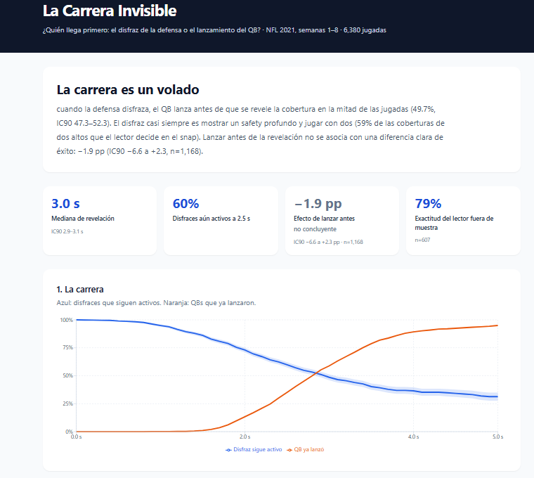

# La Carrera Invisible

Construí La Carrera Invisible: un lector de coberturas, entrenado con las semanas 1–6 del tracking del Big Data Bowl 2021 y aplicado a las 8 semanas, que cuadro por cuadro detecta si la defensa muestra uno o dos safeties profundos y mide en qué momento revela la cobertura que realmente juega.

Revela que la carrera es un volado: cuando la defensa disfraza, el QB lanza antes de que se revele la cobertura en el 49.7% de las jugadas (IC90 47.3–52.3); el disfraz casi siempre consiste en mostrar un safety profundo y jugar con dos (59% de las coberturas de dos altos decididas en el snap), y lanzar antes de la revelación no se asocia con una diferencia clara de éxito (−1.9 pp, IC90 −6.6 a +2.3, n = 1,168).

Para creerle: el lector se validó fuera de muestra en las semanas 7–8 (78.7% de exactitud contra 72.8% de una regla simple, AUC 0.84, n = 607), sus parámetros se pre-registraron antes de esa validación (commit d2146f5) y una revisión aparte reprodujo todos los conteos.

Lo usarían coordinadores ofensivos y QBs en la preparación semanal, con una tarjeta del rival cuyas probabilidades se encogen hacia la liga y están validadas con Brier, y staffs defensivos para autoscouting; no está pensado para usarse durante el partido.



## Cómo correrlo

Primero hay que preparar el entorno del hackathon con `.\.hackathon\setup.cmd`, que deja Python 3.12 en `.venv` y valida Node 22 y npm 10. Los comandos son para PowerShell y se corren desde la raíz del proyecto.

**Backend.** La API queda en `http://localhost:8000`. Calcula los resultados al arrancar, a partir de los archivos versionados de `data/derivado/`, y tarda entre 10 y 30 s.

```powershell
.\.venv\Scripts\uvicorn.exe backend.main:app --reload
```

**Dashboard.** Queda en `http://localhost:5173` y Vite redirige `/api` al backend.

```powershell
cd dashboard
npm install
npm run dev
```

El build de producción se genera con `npm run build`, dentro de `dashboard`, y queda en `dashboard/dist`.

**Regenerar el análisis desde `data/`.** Solo hace falta si cambian los datos. Toma unos minutos.

```powershell
.\.venv\Scripts\python.exe -m backend.analisis.preparar
.\.venv\Scripts\python.exe -m backend.analisis.estructura
.\.venv\Scripts\python.exe -m backend.analisis.preparar jugadas
.\.venv\Scripts\python.exe -m backend.analisis.preparar replays
.\.venv\Scripts\python.exe -m backend.analisis.metricas
```

**Validar y empaquetar la entrega:**

```powershell
.\.hackathon\setup.cmd --check
.\.hackathon\setup.cmd --entregar
```

## Datos

- **Fuente:** Big Data Bowl con la temporada 2021, semanas 1–8. Son 122 partidos y 8,557 dropbacks, con la cobertura de PFF (`pff_passCoverage`) y tracking a 10 Hz.
- **El tracking viene recortado:** empieza 0.5 s antes del snap y termina 0.5 s después del pase. Por eso la revelación se mide entre el snap y el pase.
- **Análisis:** 7,541 pases (C, I e IN) con evento de snap y de pase.
- **Universo de la carrera:** 6,380 jugadas, las que están a 20 yardas o más de la end zone y tienen una cobertura con etiqueta de uno o dos altos.
- `data/` es de solo lectura y no se versiona. Solo se versionan los derivados `data/derivado/*.csv|json`. Las exclusiones, con su conteo y motivo, están en `data/derivado/exclusiones_preparar.csv` y en `jugadas_resumen.json`.

## Método

1. **Preparación** (`preparar.py`). Las coordenadas se normalizan para que la ofensiva ataque hacia +x. El snap se toma del primer `ball_snap`, y la velocidad del balón confirma que arranca en el cuadro siguiente. El pase se toma del primer `pass_forward`. La profundidad se mide desde el balón en el snap.
2. **Lector de estructura** (`estructura.py`). Es una logística con penalización L2 sobre seis rasgos geométricos de los defensores que están a 5 yardas o más de profundidad.
   - Se entrenó con las semanas 1–6, en el cuadro de 2.0 s y solo con pases de t_pase ≥ 3 s. La l2 se eligió por validación cruzada de 5 bloques por partido.
   - Se pre-registró en el commit `d2146f5`.
   - En las semanas 7–8 tiene 78.7% de exactitud, contra 72.8% de la regla simple, con AUC 0.84, Brier 0.163 y n = 607.
   - Clasifica cada cuadro como cerrado (P ≥ 0.65), abierto (P ≤ 0.35) o indeterminado.
3. **Disfraz.** Hay disfraz cuando lo que muestra la defensa en el snap, si el lector decide, es distinto de lo que juega según PFF.
   - El índice observado es 27.8% (IC90 26.1–29.4, n = 4,606).
   - Corregido por el error del lector con Rogan-Gladen, es 21.0% (IC90 18.4–23.9).
4. **Carrera.** `revela_t` es el primer cuadro desde el cual el lector coincide con PFF y ya no cambia hasta el pase.
   - Con Kaplan-Meier censurado en t_pase, la mediana es 3.0 s (IC90 2.9–3.1).
   - En el 49.7% de los disfraces (IC90 47.3–52.3, n = 1,279) el QB lanzó antes de la revelación, es decir, a ciegas.
5. **Éxito y asociación.**
   - Una jugada es exitosa si gana 40% de las yardas por avanzar en 1.er down, 60% en 2.º y 100% en 3.º y 4.º. La intercepción cuenta como fracaso y las jugadas con castigo se excluyen.
   - Con una logística de éxito sobre "a ciegas" y controles (tramo de t_pase, down, distancia, zona del campo, n_rushers, shotgun y play action), el efecto marginal promedio es −1.9 pp (IC90 −6.6 a +2.3, n = 1,168).
   - Con Mantel-Haenszel da −1.1 pp (IC90 −5.7 a +3.0), y sin las 121 jugadas con discrepancia de línea, −1.4 pp (IC90 −6.2 a +2.7).
6. **Defensas.** El índice por defensa usa una beta-binomial empírica. Su estabilidad split-half, comparando partidos impares contra pares, es r = 0.68 (Spearman-Brown 0.81).
7. **Intervalos.** Son de 90% por bootstrap por partido (`gameId`), salvo donde se indica Wilson, Greenwood o Fisher z. Todas las semillas son fijas.

El código está en `backend/analisis/`:
- `modelos.py`: las funciones estadísticas.
- `metricas.py`: `resumen()`, `equipos()`, `rival()` y `replays()`, con la forma exacta del contrato de la API (`.kiro/specs/la-carrera-invisible/design.md`).

## Límites principales

- **Es una asociación, no un efecto causal.** El error del lector depende de t_pase, así que el sesgo del efecto puede ir en cualquier dirección.
- **Los sacks están fuera del universo:** los 543 sacks no entran, porque sin pase no hay t_pase. El análisis está condicionado a que el QB alcanzó a lanzar.
- **El lector no está validado en el snap:** se validó a 2.0 s en pases de ≥ 3 s. Aun así, una regla geométrica que no se entrenó encuentra la misma asimetría en el snap (revisión independiente, `docs/revision.md`).
- **t_pase podría ser mediador:** según cómo se controle t_pase, el efecto da −1.6, −1.5 o −0.9 pp, y ningún IC excluye 0 (revisión independiente).
- La mediana de revelación supone que el momento del pase no depende de la revelación.
- **El ranking por defensa refleja en parte la mezcla de coberturas:** tiene r = 0.53 con la tasa de dos altos.

## Uso de IA

- **Programación:** se usaron Claude Code y Kiro. Claude Code escribió el análisis (`backend/analisis/` y `docs/`), y Kiro escribió la app (`backend/main.py`, `backend/informe.py` y `dashboard/`).
- **Revisión:** una segunda sesión de Claude Code revisó el trabajo por separado (`docs/revision.md`). Sus hallazgos bloqueantes se corrigieron en el commit `3765936`.
- **Amazon Nova** (vía Bedrock) solo redacta el informe semanal (`POST /api/informe`). Cada número del texto se verifica contra los datos. Si alguno no cuadra, o si Bedrock no responde, se usa una plantilla determinista. La app funciona sin Nova.
- Las decisiones de análisis las tomó el equipo y quedaron registradas en `docs/decisiones.md`.

## Documentación

- [docs/descubrimiento.md](docs/descubrimiento.md): resultados con n e IC, ranking por defensa y límites.
- [docs/decisiones.md](docs/decisiones.md): cada decisión de método, en orden.
- [docs/replays.md](docs/replays.md): la regla con que se eligieron las repeticiones.
- [docs/revision.md](docs/revision.md): la revisión independiente.
